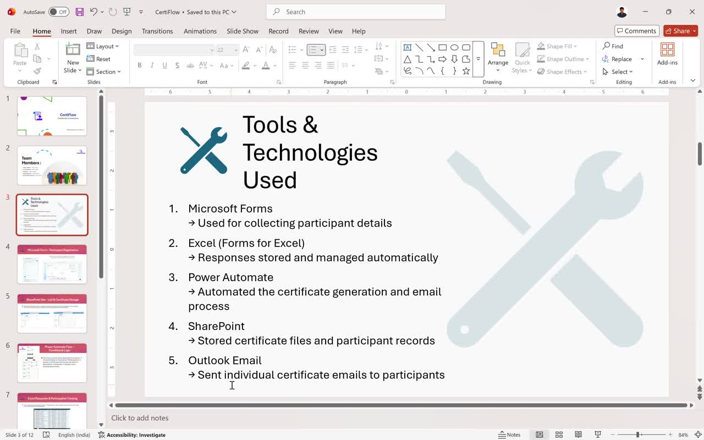
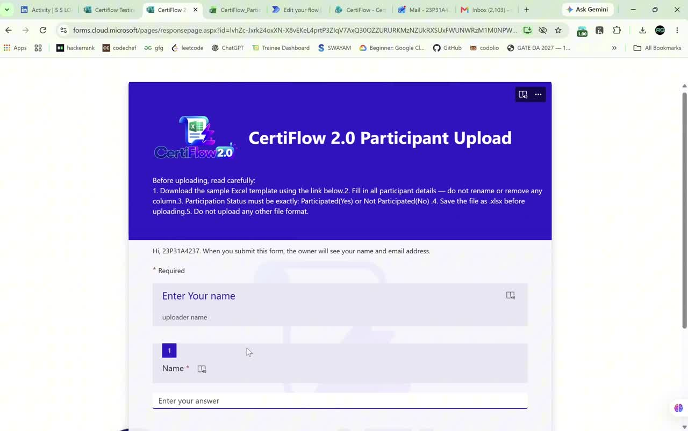
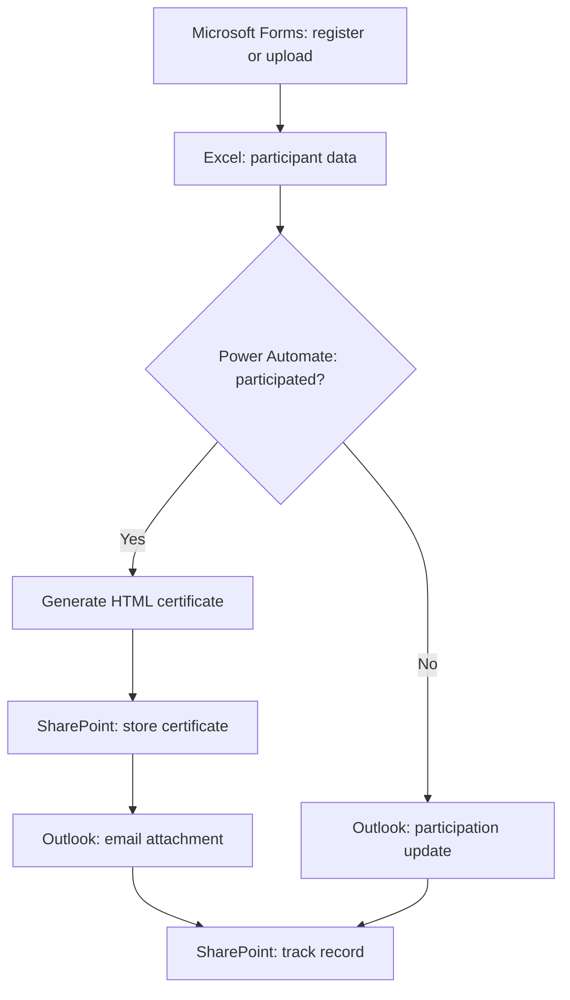

<div align="center">

# CertiFlow.
### From participation to recognition.

A Microsoft 365 certificate automation project, presented through an interactive showcase.

**[Explore Version 1](https://forms.cloud.microsoft/r/B378DcdeTQ) · [Explore Version 2](https://forms.cloud.microsoft/r/1AAeEHv1w3)**


**Microsoft Forms · Excel · Power Automate · SharePoint · Outlook**

</div>

---

## The project

CertiFlow connects participant data, participation checks, personalized HTML certificate generation, email delivery, and record tracking.

- **Version 1:** Individual registration with conditional certificate delivery.
- **Version 2:** Organizer uploads an Excel workbook to process multiple participants, with organizer personalization and master records.

The website is a showcase of the Microsoft 365 implementation. It does not run the cloud flow itself.

## Watch the project

| CertiFlow 1 | CertiFlow 2 |
| --- | --- |
| [](project-files/certiflow_1/certiflow1_video.mp4) | [](project-files/certiflow_2/certiflow_1_video.mp4) |
| [Watch individual registration · 05:50](project-files/certiflow_1/certiflow1_video.mp4) | [Watch bulk participant upload · 07:28](project-files/certiflow_2/certiflow_1_video.mp4) |

## How the pieces connect



## The showcase

- Compact light interface with Manrope headings and DM Sans body text
- Original CertiFlow 1 logo in the header, footer, and browser tab
- One keyboard-accessible version selector with each version’s original logo
- Short instructions, Microsoft Forms demos, and video walkthroughs
- Excel template download for bulk uploads and expandable extra help
- Five highlighted team cards and a clickable GitHub repository preview
- Subtle transitions with reduced-motion support
- Plain HTML, CSS, and JavaScript; no build step

## Run locally

Open `index.html` in a modern browser, or serve the directory:

```bash
python3 -m http.server 8080
```

Visit http://localhost:8080.

## Publish with GitHub Pages

1. Push the contents of this folder to the repository root.
2. Open **Settings → Pages**.
3. Under **Build and deployment**, select **Deploy from a branch**.
4. Choose **main** and **/ (root)**, then save.
5. GitHub displays the final Pages URL after deployment.

All site assets use relative paths, including videos. No repository-specific URL replacements are necessary.

## Project archive

All **38 supplied project files** are preserved without changing their contents.

| Folder | Contents |
| --- | --- |
| [Version 1 archive](project-files/certiflow_1/) | Process PDF, slides, original demo, sample HTML, team write-up, original screenshots, and participation workbook |
| [Version 2 archive](project-files/certiflow_2/) | Upload template, demo, form pages, master table screenshot, certificate sample, and email screenshots |
| [Website assets](assets/) | Optimized screenshot copies, video posters, downloadable template, favicon, and README banner |

## Repository layout

```text
index.html
styles.css
app.js
assets/
  favicon.svg
  certificate-v1.webp
  certificate-v2.webp
  dashboard.webp
  flow-v1.webp
  flow-v2.webp
  form-v1.webp
  form-v2.webp
  sharepoint.webp
  video-v1.jpg
  video-v2.jpg
  CertiFlow_Participant_Template.xlsx
project-files/
  certiflow_1/   # Original supplied version 1 files
  certiflow_2/   # Original supplied version 2 files
README.md
.nojekyll
```

The original supplied project folders are preserved, including their original filenames. The video named `certiflow_1_video.mp4` inside `certiflow_2` is the version 2 recording.

## Using version 1

Open its live form, fill the participant details, choose participation status, and submit. The connected flow sends eligible participants an HTML certificate and sends non-participants a notification without a certificate.

## Using version 2

Download `assets/CertiFlow_Participant_Template.xlsx`. Replace or remove sample records, fill the participant rows, keep column headers and `ParticipantsTable` unchanged, save as `.xlsx`, and upload through the version 2 form. The current workbook uses `Yes` and `No`; `Yes/No` is a sample placeholder. Follow any updated instructions in the live form.

Forms access, email timing, and automation availability depend on the Microsoft 365 configuration. The file-upload form may require organization sign-in.

## Certificate format

The demonstrated attachment is HTML. Recipients can open it in a browser and use Print → Save as PDF. Automatic PDF conversion is not claimed by the showcase.

## Team

**Pool 1 · Team 4 · Technical Hub internship project**

| Member | Roll number |
| --- | --- |
| K.S.S. Lokesh | 23P31A4237 |
| K. Vinay Gupta | 23P31A05G5 |
| M. Kedhar | 23P31A4248 |
| M. Sai Sumanth | 23P31A05H3 |
| Mohan Mani Shankar | 23A91A6171 |

Lokesh's supplied write-up describes his contribution as the Power Automate workflow and integrations. Other individual responsibilities are not specified in the supplied files.

With thanks to mentors **Nagendra Kishore Girajala** and **Jakke Harshavardhini**, and **Babji Neelam**, Founder & CEO, Technical Hub.

## Updating content

- Form links: `index.html` and the `versions` object in `app.js`.
- Team, mentors, and project copy: `index.html`.
- Styles and responsive layout: `styles.css`.
- Videos: preserve the current paths or update `app.js` and the fallback video link in `index.html`.
- Google Fonts is optional; the site falls back to system fonts when unavailable.
- The original Microsoft 365 automation must be maintained separately from this website.

Independent student project. Microsoft product names belong to their respective owners.
